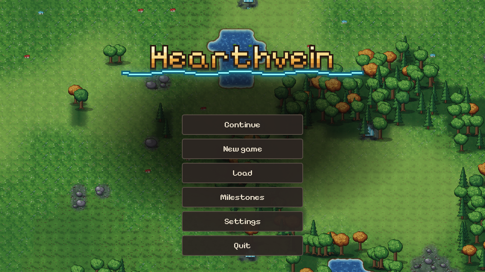
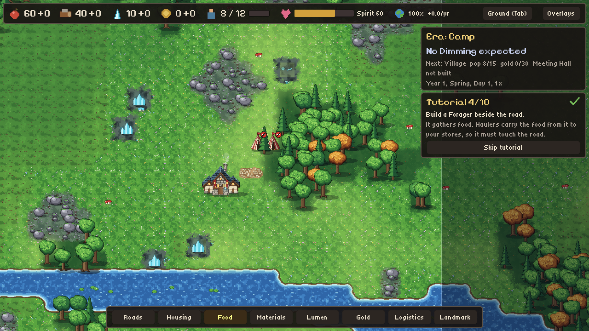
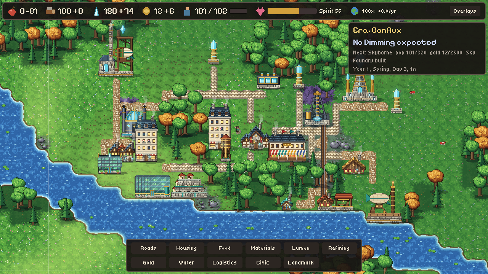
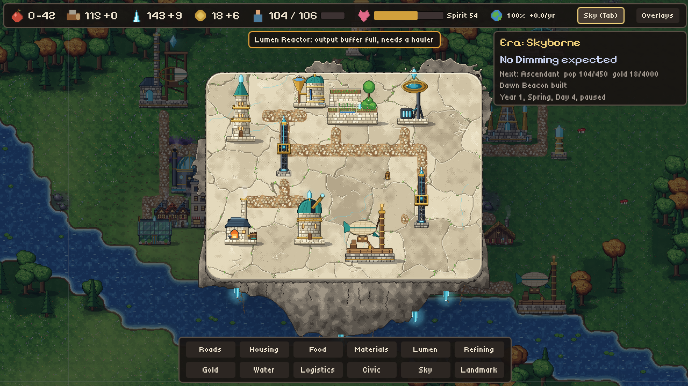

# Hearthvein

Grow one settlement from a camp around the Hearth into a glowing sky city on a living planet.

Lumen, the cyan energy in the veins under the ground, powers everything. Pumping it sickens the land and drains
the planet. Every year the veins go quiet for a while (the Dimming), and each Dimming runs longer as the eras
advance and as the planet gets sicker. Climb seven eras (Camp, Village, Town, City, Conflux, Skyborne,
Ascendant), lift districts into the sky, heal the land, finish the Skyheart and survive the Great Dimming with
the planet still standing. There's an endless mode for after the campaign.

| | |
|---|---|
|  |  |
|  | |

## Download

Get the latest build from [Releases](https://github.com/LastNyx/hearthvein/releases/latest):

- Windows: `Hearthvein-<version>-setup.exe`
- Linux: `Hearthvein-<version>-x86_64.AppImage` (`chmod +x` it, then run it) or the `.tar.gz`

New players: start a New game with the tutorial on. F1 opens the help screen at any time.

## Controls

- Left click place / select; right click cancel; mouse wheel zoom
- Right drag, middle drag or WASD to pan; Tab switches between the ground and the sky layer
- Space pause, 1 / 2 / 3 speed, B build menu, R road, C channel, X demolish, U upgrade, M region map
- F1 help, Esc pause menu

## Build from source

Requires Godot 4.7.2 (standard, non-.NET build) as `godot` on your PATH.

- Run the game: `godot --path .`
- Run the whole test suite headless: `tools/test.sh`
- Run one test file: `tools/test.sh test/test_smoke.gd`
- Build the release packages: `packaging/build.sh` (output in `build/`)

Tests use [GUT](https://github.com/bitwes/Gut) 9.7.1, vendored in `addons/gut`. `tools/test.sh` imports the
project on first run (when `.godot/` is missing) and exits with GUT's exit code: 0 on pass, non-zero on
failure. Test files go in `test/` and are named `test_*.gd`.

Layout: `sim/` (pure simulation, no scene-tree code), `data/` (all game numbers, as `.tres`), `render/`,
`ui/`, `test/`, `tools/` (shot scripts, balance bot, art export). Design docs are in `docs/`.

## Build from source

`packaging/build.sh` exports the Windows and Linux builds into `build/` (needs the export templates, NSIS and appimagetool). It refuses to run unless `CHANGELOG.md` has a `## <version>` section for the version in `project.godot`. `CHANGELOG.md` is the one source for the in-game What's new panel and the GitHub release notes: `packaging/release_notes.sh <version>` prints that version's section (use it with `gh release create --notes-file`).

## Licence

The code is MIT (see [LICENSE](LICENSE)). Third-party assets keep their own licences: the fonts in `assets/ui`
(SIL Open Font License 1.1, see the `*-OFL.txt` files), the sounds in `assets/audio` (see
`assets/audio/CREDITS.md`) and the GUT test addon in `addons/gut` (see its `LICENSE.md`).
